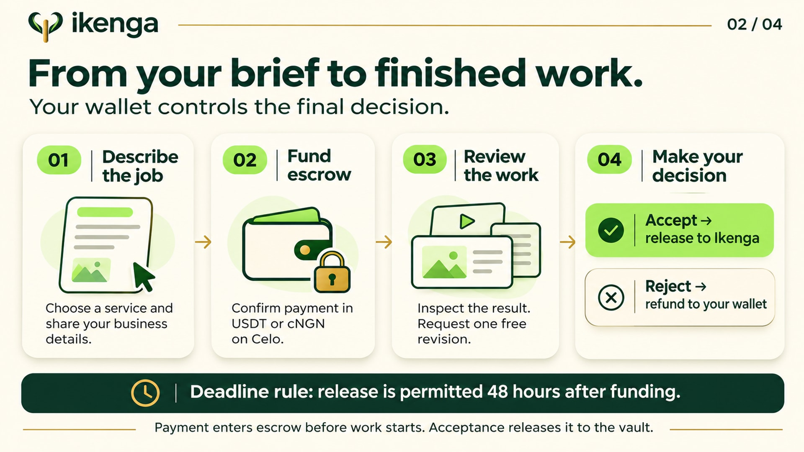
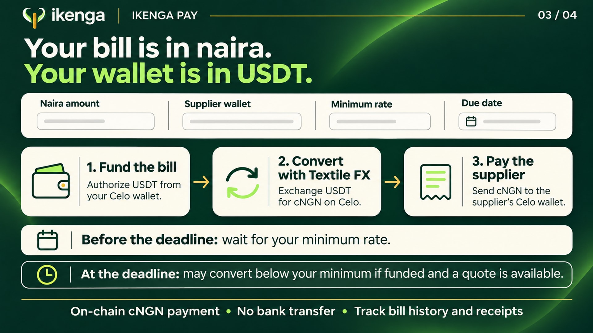
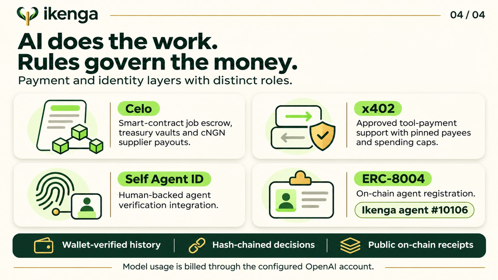
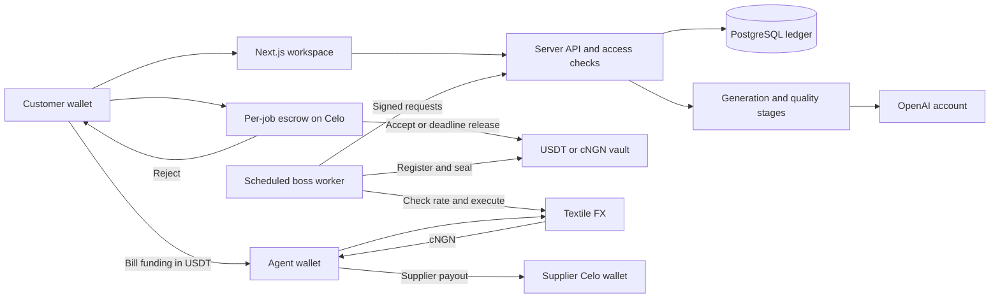

# Ikenga

**An AI team for your business. Clear rules for the money.**

Ikenga helps small businesses create a website, flyer and price list, promo video, or market report for **$1 per job**. Customers pay in USDT or the equivalent cNGN on Celo, follow the work in a job workspace, and review the result before accepting or rejecting it. A separate **Ikenga Pay** flow converts funded USDT into cNGN to pay a supplier's Celo wallet.

Models create and check the work. Deterministic application code and smart contracts enforce pricing, spending controls, escrow, and settlement rules.

**Try it:** [useikenga.xyz](https://www.useikenga.xyz) · [Public activity](https://www.useikenga.xyz/activity) · [Agent registration](https://www.useikenga.xyz/agent.json)

## At a glance

| | Ikenga |
| --- | --- |
| Network | Celo mainnet, chain ID `42220` |
| Creative services | Business websites, flyers and price lists, promo videos, market reports |
| Job price | `1 USDT`, or its quoted cNGN equivalent fixed when the job is created; network fees are separate |
| Job payment | Per-job escrow: accept releases to the vault; reject refunds; a 48-hour deadline also permits release |
| Ikenga Pay | Fund a naira bill in USDT; Textile FX converts to cNGN for the supplier's Celo wallet |
| Returning customers | Wallet-verified job history and funded-bill history |
| Identity | Self Agent ID verification integration and ERC-8004 agent registration `10106` |
| Payment infrastructure | Celo contracts, separate USDT/cNGN vaults, and x402 support for approved tool payments |

## Product tour

These are **illustrative product explainers**, created for the submission. They describe the app's flows; they are not live account balances, transaction receipts, or evidence that every integration has completed a live payment. The live app and explorer show current state.

**The workspace.** Choose a service, write a useful brief, and pay with USDT or cNGN. Ikenga Pay handles supplier bills separately from the fixed-price creative jobs.


**The job journey.** Describe the work, fund escrow, review the deliverable, and make the acceptance decision with the wallet that paid.



**Ikenga Pay.** Set a naira amount, supplier wallet, minimum exchange rate, and due date. Fund the bill in USDT and follow conversion and payout receipts.



**The technology.** Escrow, tool-payment support, agent verification, and agent registration serve different purposes.



## What can the team deliver?

| Service | What the customer provides | What the customer receives |
| --- | --- | --- |
| Business website | Business details, audience, brand direction, services, prices, and contact | A responsive single-page website, an in-app preview, and a downloadable HTML page |
| Flyers & price list | Offer, confirmed items and prices, contact, and design direction | Branded artwork with preview and PNG/PDF exports for new-format flyers; legacy work retains its original controls |
| Promo video | Offer, audience, key messages, contact, and brand direction | Designed animated slides, plus a silent portrait video export: MP4 where supported, otherwise WebM |
| Market report | Business question, research subjects, region, and decision to support | A structured report with source links, comparison tables where relevant, evidence limits, and recommended actions |

The promo export is a video made from delivered slides. Product voiceover is not included in the current exporter. Generated websites are downloadable pages; buying a job does not register a domain or deploy a separate customer website automatically.

## How a creative job works

1. **Choose a service and describe the business.** Guided brief fields collect the audience, goal, contact, brand, and service-specific facts. Confirmed prices and contact details are used to check the result.
2. **Connect a Celo wallet and review the quote.** Choose USDT or cNGN. The cNGN quote comes from Textile FX and is fixed for that job. Wallet sign-in proves access to private history; it does not authorize a payment.
3. **Create and fund the job's escrow.** The customer confirms deployment, token approval, and funding through their wallet as required. The money is held by that job's contract before generation starts.
4. **Follow the team.** The job page displays progress through generation and checks. The scheduled boss worker can continue stages when the page is closed and registers the escrow with the appropriate vault.
5. **Review the result.** Inspect the deliverable and, while eligible, request one free revision. The worker seals a fingerprint of the deliverable on-chain. Already sealed or settled work cannot be silently replaced.
6. **Accept or reject with the paying wallet.** Acceptance requires a submitted deliverable hash and releases the escrow price to the appropriate vault. Rejection returns the escrow price to the customer. New jobs currently use a **zero bond**, so an extra bond refund is not promised.

**The deadline starts at funding, not delivery.** After 48 hours from `fundedAt`, anyone may call `deadlineRelease()` to release the price to the vault. This is an alternative settlement path, so acceptance is not the only way funds can leave escrow. Passing the deadline alone does not broadcast a transaction.

USDT and cNGN remain separate. Accepting a cNGN job releases cNGN into its cNGN vault; it does not convert the payment into USDT.

## How Ikenga Pay works

Ikenga Pay is a supplier-payment corridor, separate from the $1 creative-job escrow.

1. **Create a bill** with the payer name, purpose, naira amount, supplier's Celo wallet, due date, and minimum naira-per-dollar rate. Creating a bill spends nothing.
2. **Review the funding amount** after the worker obtains a Textile FX preview. Confirm the USDT transfer from your wallet to the displayed agent wallet. A manually submitted funding hash is checked on-chain before it counts.
3. **Wait for the rate.** Before the deadline, the worker waits when the effective rate is below the minimum. At or above the minimum, it requests an executable quote. At the deadline it can proceed below the minimum, subject to sufficient funding, liquidity, gas, and a valid quote.
4. **Convert and pay.** The worker approves and exchanges USDT for cNGN through Textile FX, then sends the bill's cNGN amount to the saved supplier wallet. Conversion and payout are distinct, resumable steps.
5. **Check the bill and history.** The bill page shows its funding, observed rate, status, and available receipts. Verified funding links a bill to the payer wallet's history.

A funding transaction can belong to only one bill. If the required USDT increases before conversion, the bill waits for a top-up. If conversion needs less, surplus USDT stays in the agent wallet; it is **not automatically refunded**.

Payment is in **cNGN on Celo**, not a naira bank transfer. Funding a bill transfers USDT to an operator-controlled agent wallet; it does not receive the creative job's escrow/refund protections.

## Creative job or supplier bill?

| | Creative job | Ikenga Pay |
| --- | --- | --- |
| Purpose | Buy a website, flyer, promo, or report | Pay a supplier an amount owed in naira |
| Funding | Fixed job price in USDT or cNGN | USDT required for the bill's current FX quote |
| Where funds wait | The customer's per-job escrow contract | The agent wallet, associated with verified bill funding |
| Completion | Customer acceptance, rejection, or eligible deadline release | Textile FX conversion followed by supplier cNGN payout |
| Refund behavior | Rejecting a funded job invokes the contract refund | No equivalent job-escrow refund; unused funding is not automatically returned |
| Timing | Generation stages, customer review, and the escrow deadline | Worker schedule, chosen rate/deadline, funding, and available quotes |

## The AI team and CFO

The workspace presents ten roles: **Scout, Researcher, Reader, Writer, Designer, Producer, Investigator, Analyst, Auditor, and Messenger**. The service determines which roles and stages run. These are workflow roles; the interface does not imply ten independently paid wallets or ten separate models.

New jobs use the upgraded delivery pipeline:

- Structured fact extraction and guided briefs give the team confirmed business information.
- Analyst and Auditor checks must pass before delivery. Unsupported prices and currency changes also have deterministic checks.
- Research stages plan the question, retrieve sources, record retrieval context, and check evidence coverage. Source links and evidence limits remain important when assessing a report.
- Flyer artwork renders confirmed prices and contact information directly from structured data. Its preview and exports share the same artwork.
- A shared stage lease prevents competing requests from finalizing the same stage. Paid calls reserve a spending allowance before execution; interrupted or unknown usage keeps conservative reservations.

The CFO's prices, limits, FX decisions, and transaction checks are code. Models produce content and quality judgments; their prose is not permission to transfer arbitrary funds. Spending reservations are application controls, not a provider-side billing cap. Historical jobs retain their saved content, original contract references, and compatible processing paths. See [delivery upgrade notes](docs/ai-delivery-upgrade.md).

## Payment and identity technology

| Technology | Its role in Ikenga |
| --- | --- |
| Celo and Solidity | `JobEscrow` and `IkengaVault` hold and release job payments, enforce vault rules, and expose transaction receipts |
| Textile FX | Preview and firm-quote APIs for USDT-to-cNGN conversion; the worker executes the returned swap and sends the supplier payout |
| x402 | Buyer/facilitator integration for approved tool payments, with pinned payees and per-call spending caps; support does not mean every model call settles through x402 |
| Self Agent ID | Human-backed agent verification through the SDK and on-chain registry reads; verification outcomes are recorded |
| ERC-8004 | Public agent registration: Ikenga is agent **10106** on Celo's identity registry |
| OpenAI | Content generation and independent audit-model calls, billed through the configured server-side OpenAI account |
| ERC-8021 attribution | Tags the app's own supported transaction sends; Textile swap calldata is preserved, and facilitator-submitted x402 settlements are a separate attribution case |

Self Agent ID and ERC-8004 are different checks. An ERC-8004 registration is not proof of a current Self verification. The standalone agent payment path can refuse unverified agents; the web generation flow records Self results without treating a failed lookup as a reason to discard the customer's work. The escrow's on-chain acceptance rules remain separate from those identity checks.

## Architecture

The web app handles briefs, wallet sign-in, job pages, and API requests. PostgreSQL persists orders, deliverables, decisions, bill funding, and receipts. A separate scheduled worker signs scoped API requests and performs the privileged on-chain operations needed for escrow registration, deliverable sealing, and bill processing.



The web server does not need the vault boss key. That key belongs only in the worker's server-side runtime. The worker checks the site's chain configuration and the escrow's own vault rather than assuming every historical job uses the same currency or address.

## History, privacy, and receipts

- **My jobs** requires a signed wallet session and returns that wallet's jobs. Customer briefs, deliverables, and job decision text require authorized access. The worker has a separate, scoped signed-request path.
- **My bill history** requires wallet sign-in and matches bills through verified funding ownership. An unfunded bill is not yet associated with a payer through a verified funding transfer.
- **Bill detail links currently identify accessible bill records.** Treat a bill link as shareable receipt access; do not assume job-page access controls also protect every bill-detail endpoint.
- Public activity shows aggregates. Blockchain addresses, token movements, hashes, and any content a customer chooses to publish remain public.
- Decision records are **hash-chained** and checked for consistency. The current ledger does not provide a cryptographic signature for every decision, and a matching hash chain does not establish that a model's factual claims are true.

## Mainnet contracts and public evidence

The deployed configuration supports Celo mainnet (`42220`). Token amounts use 6 decimals. The live [`/api/chain`](https://www.useikenga.xyz/api/chain) response is the runtime reference; environments can override configured addresses.

| Contract or token | Mainnet address |
| --- | --- |
| USDT | [`0x48065fbBE25f71C9282ddf5e1cD6D6A887483D5e`](https://celo.blockscout.com/address/0x48065fbBE25f71C9282ddf5e1cD6D6A887483D5e) |
| cNGN | [`0xF6829D7393dAe24509eb1E52eE8e572e2E271a4f`](https://celo.blockscout.com/address/0xF6829D7393dAe24509eb1E52eE8e572e2E271a4f) |
| USDT vault | [`0x1C2b2E64527B0bA7795ed3CDF7d76da51D24018B`](https://celo.blockscout.com/address/0x1C2b2E64527B0bA7795ed3CDF7d76da51D24018B) |
| cNGN vault | [`0x5D649BBd5fAb11ABf28817A3be62bc5991772B1E`](https://celo.blockscout.com/address/0x5D649BBd5fAb11ABf28817A3be62bc5991772B1E) |
| ERC-8004 identity registry | [`0x8004A169FB4a3325136EB29fA0ceB6D2e539a432`](https://celo.blockscout.com/address/0x8004A169FB4a3325136EB29fA0ceB6D2e539a432) |

**Each creative job has its own escrow.** Use the address on that job's page; the initial deployment's `JobEscrow` address is not a universal payment destination. Public deployment records are in [contracts/deployments/celo.json](contracts/deployments/celo.json).

An earlier completed cNGN job has a public funding-to-settlement trail:

- [Funding: 1,454 cNGN into the job escrow](https://celo.blockscout.com/tx/0xf26b725235414731d99a019618fedd030d58c2ef6cf83f75ab78d03552d2ef31)
- [Deliverable fingerprint submitted](https://celo.blockscout.com/tx/0x787db050e953d215e46f8cdfa83bd9fd909361351ab6c98f04f0092e4614e62d)
- [Customer acceptance and settlement](https://celo.blockscout.com/tx/0xb3cbb56b9d086694a519adedcc8ab4fc61b09fdeac3f392fd4ad06665dbf0416)

The public activity API reported **4 customer jobs across 4 customer wallets** when checked on **26 November 2026**. This is a dated snapshot, not a permanent counter. These historical receipts are separate from the illustrative tour graphics and do not establish a live x402 tool settlement or a completed bill conversion.

## Technology and repository layout

Next.js 16, React 19, TypeScript, and Tailwind CSS power the interface. `viem` handles wallet interactions and chain reads. The server uses PostgreSQL or an in-memory development fallback, with Zod schemas and shared TypeScript packages. Contracts use Solidity and Foundry. The production web app is hosted on Vercel; the boss worker runs separately on a scheduled server.

```text
apps/web/          Workspace, wallet sign-in, job and bill pages, server APIs
apps/agent/        Generation, research, auditing, CFO/FX logic, boss worker
packages/shared/   Types, validation schemas, pricing, shared artwork renderers
packages/ledger/   PostgreSQL schema, memory/Postgres ledgers, decision hash chain
packages/payments/ Celo contracts/client helpers, Textile FX, x402, Self verification
contracts/         JobEscrow, IkengaVault, Foundry tests and deployment records
docs/              Product flows, implementation notes and tour graphics
```

## Run locally

Use Node.js 22 or later and the repository's pinned **pnpm 10.15.0**. Docker is optional for local PostgreSQL; Foundry is needed for contract tests.

```bash
git clone https://github.com/vickman787/ikenga.git
cd ikenga
pnpm install
cp .env.example apps/web/.env.local
docker compose up -d postgres
pnpm build:packages
pnpm --filter @ikenga/agent build
pnpm dev
```

Open `http://localhost:3000`. Set the server variables in `apps/web/.env.local` before using authenticated or generated work:

| Variable | Purpose |
| --- | --- |
| `OPENAI_API_KEY` | Server-side content and image generation; provider calls incur usage charges |
| `IKENGA_SESSION_SECRET` | A unique random server secret of at least 32 bytes for wallet sessions |
| `DATABASE_URL` | Persistent PostgreSQL ledger; the example matches Docker on port `5433` |
| `IKENGA_CHAIN` | `mainnet` by default; `sepolia` for separately configured test contracts |
| `CELO_RPC_URL` / `CELO_SEPOLIA_RPC_URL` | RPC endpoints for the selected network |
| `IKENGA_VAULT_ADDRESS` / `IKENGA_TOKEN_ADDRESS` | Optional mainnet overrides; required for a Sepolia deployment |
| `IKENGA_CNGN_VAULT_ADDRESS` | Optional cNGN vault override; the committed mainnet deployment supplies a default |
| `SELF_AGENT_ADDRESS` / `SELF_AGENT_ID` | Identity to check; additional Self settings are in `.env.example` |
| `IKENGA_ATTRIBUTION_TAG` | Assigned transaction attribution code |

Without Docker, clear `DATABASE_URL` to use the in-memory development ledger; data will not survive process restarts and it is unsuitable for production. The ledger initializes its schema when started against PostgreSQL.

**Localhost does not imply testnet.** The default configuration is Celo mainnet. For isolated chain testing, configure Sepolia with its own vault and test token; the USDT-to-cNGN bill corridor is mainnet-only. A read-only preview build can enable `NEXT_PUBLIC_IKENGA_READ_ONLY=1`; `/examples` is available only in that mode and contains fictional fixtures.

Never put provider keys, session secrets, or wallet keys in `NEXT_PUBLIC_` variables or commit real environment files.

### Scheduled worker

The worker is a separate operator process. It requires the selected chain, an explicit `IKENGA_SITE_URL`, its authorized boss key, RPC access, and the attribution tag. Put these in an ignored server-side environment file and set `IKENGA_ENV_FILE` to that path. Use the same chain configuration as the web app. The web server does not need this key.

```bash
pnpm build:packages
pnpm --filter @ikenga/agent boss
```

This command runs **one pass and exits**; schedule it externally, for example every five minutes. A pass can register escrows, seal deliverables, advance generation stages, and execute funded mainnet bill swaps and payouts. It is an operational command, not a read-only health check. Do not run two independent production schedules against the same worker wallet.

The worker sends signed, scoped API requests. Deploying wallet-access changes requires a compatible worker; do not restore an older unsigned client without checking compatibility. See [worker implementation](apps/agent/src/boss-worker.ts) and [signed-request helper](apps/agent/src/worker-auth.ts).

## Checks

```bash
pnpm test
pnpm typecheck
pnpm build
```

Run contract tests from the `contracts` directory:

```bash
forge test
```

Live-gated scripts, including `pnpm --filter @ikenga/agent exec:sepolia`, require explicit test-network configuration and funded test wallets. They are separate from offline unit tests.

Current limitations include browser-dependent MP4/WebM support, silent promo exports, provider and quote availability, and the need for further isolated real-PostgreSQL concurrency and live-model output evaluation. Unit tests and deployments are not an independent contract audit. See [SECURITY.md](SECURITY.md).

## Further reading

- [Architecture](docs/architecture.md)
- [AI delivery upgrade](docs/ai-delivery-upgrade.md)
- [cNGN creative-job payments](docs/cngn-jobs.md)
- [Naira bill implementation and funding rules](docs/naira-bill.md)
- [Contract source](contracts/src/JobEscrow.sol) and [vault source](contracts/src/IkengaVault.sol)

Some older development notes describe staged milestones. The current README, implementation, deployment records, and live runtime configuration take precedence over historical rollout checklists.

## License

[MIT](LICENSE).

