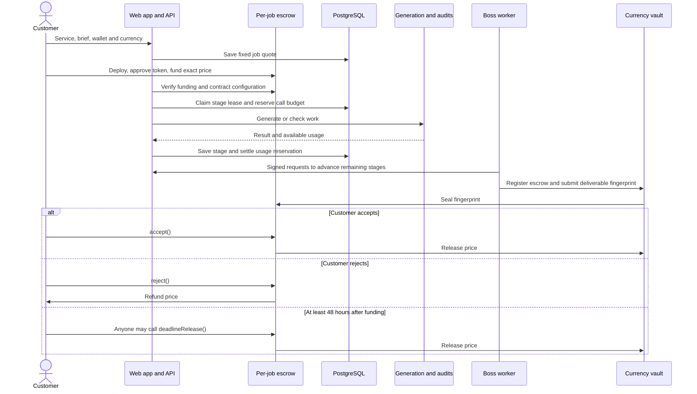
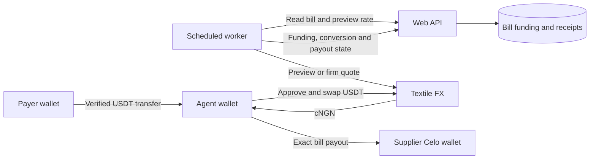

# Ikenga architecture

Ikenga separates content generation, customer authorization, persistent records, and money movement. The web app runs on Vercel; a separate scheduled boss worker performs privileged contract calls and bill processing. The [README](../README.md) is the product-level guide.

## Components

| Component | Responsibility |
| --- | --- |
| `apps/web` | Next.js workspace, guided briefs, wallet sessions, owner job views, bill pages, public aggregates, server APIs |
| `apps/agent` | Content/research stages, analyst and auditor checks, deterministic CFO/FX decisions, and the boss worker |
| `packages/shared` | Types, Zod validation, pricing rules, artwork and presentation data |
| `packages/ledger` | Orders, reports, bill funding, receipts, hash-chained decisions, PostgreSQL and memory implementations |
| `packages/payments` | Contract reads and wallet helpers, Textile FX, x402 clients/facilitator, Self verification, transaction attribution |
| `contracts` | Solidity `JobEscrow` and `IkengaVault`, Foundry tests, scripts, public deployment records |

## Creative jobs

The deadline is measured from funding, not delivery. `deadlineRelease()` is a separate callable settlement path; the clock does not send a transaction itself. New jobs currently use a zero bond. USDT and cNGN escrows release to their own currency vaults.

The browser and worker can both request generation stages. Short PostgreSQL transactions acquire a shared lease and persist the call reservation; the database connection is not held during provider requests. A stale lease cannot finalize a replacement stage. Unknown or interrupted usage retains a conservative reservation. New jobs use generator version 2; older saved progress follows its compatible pipeline. See [delivery implementation notes](ai-delivery-upgrade.md).

## Supplier bills

Bill funds are held in the agent wallet, not a creative-job escrow. Recorded funding must cover the current quote, and a funding transaction cannot be reused for another bill. The worker checks the rate, available balance, contracts, recipient, and payout amount. Before the deadline it refuses below the minimum; at the deadline it can convert below the minimum if sufficiently funded and an executable quote is available. A completed conversion with a pending payout can resume on another pass. Surplus USDT is not automatically refunded. Details are in [naira bill notes](naira-bill.md).

## Identity, tools, and authority

Self Agent ID integration checks the configured agent using the SDK and registry reads. The standalone payment runner can refuse an unverified agent; the web generation path records Self outcomes without discarding a job when the check fails. ERC-8004 is a separate public registration: Ikenga is agent `10106`. Neither integration substitutes for the escrow's own customer and settlement checks.

The x402 package supports capped payments to approved, pinned tool payees. OpenAI generation uses the configured provider account. Do not treat x402 support as evidence that every live model call has an on-chain tool-payment receipt.

The boss worker makes signed, scoped API requests. Worker access checks recover the signer and read boss authority from the configured vault. The web runtime does not need the worker's private key. A worker pass checks the site's chain configuration before acting and resolves each job's vault from the escrow.

## Data and visibility

PostgreSQL is the persistent backend. `MemoryLedger` is a process-local development fallback and does not survive restarts. Decision records are hash-chained; cryptographic signing of every ledger entry is not enabled.

Job pages and history require owner wallet access or authorized worker scope. Bill history is restricted to the funding wallet. Bill-detail routes are currently accessible by bill ID, so bill links should be treated as receipt access. Public activity is aggregate-only; blockchain transactions remain public. See [security and trust boundaries](../SECURITY.md).

## Running the worker

`pnpm --filter @ikenga/agent boss` runs one pass and exits. An external scheduler invokes it repeatedly; it is not a daemon and not a read-only health probe. A configured mainnet pass can register escrows, seal deliverables, advance stages, and execute funded bill conversions and payouts. Keep one active production schedule and supply the correct server-side environment.

